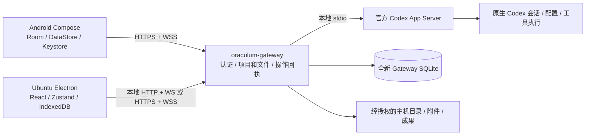

# Oraculum 2.0 Phase 0｜总体架构规格与审阅入口

> 2026-11-11 结项同步：[Phase 0](https://app.notion.com/p/4155421e690b81829fe6ce746cff195d) 已获用户接受并结项，[Phase 1](https://app.notion.com/p/4155421e690b818b8d19e6ab806641bd) 已获授权。本文保留 Phase 0 的研究证据；最新裁定见[升级子项目](https://app.notion.com/p/4135421e690b815eb404c3024c860134)。Android 后续按同一 Stitch 设计和 Compose ColorScheme 实现 Light / Dark / OLED Dark，仅做必要 token、对比度与可访问性验证，不另做设计稿或反复视觉审阅。旧 CSS 主题、Theme API v1 和历史偏好不要求迁移；Desktop 高级可导入主题为可选范围。Phase 1 不开发客户端 UI、不改 Stitch 原件，也不授权正式部署。

状态：**Phase 0 研究交付已获接受，Task 已结项；Phase 1 已独立批准并正式立项。以下未实施陈述均指原 Phase 0 研究时点。**

研究日期：2026-11-11。源码基线：`3f98a0f506f7c372ed1743f1201ad23136c8c639`。本轮开始时 `git fetch origin main` 成功，`HEAD...origin/main` 为 `0 / 0`；既有未提交内容为用户的 Stitch 设计目录。本规格中的未来结构、接口、表和技术参数均为 Phase 0 推荐，不能理解为已实施、已验收或新的生产操作授权。

## 1. 结论与阅读顺序

推荐沿用现有 Node.js / TypeScript / Fastify / SQLite 后端基础，把它收敛为 `oraculum-gateway`；保留官方 Codex App Server 的本地 stdio 接口作为唯一执行通道。Android 用 Kotlin + Compose，Ubuntu 保留 Electron + React + TypeScript + Zustand。两个客户端各自打包界面、保存草稿和历史缓存，共享经过版本管理的数据契约，不共享页面，也不把 Gateway 改造成第二套会话执行引擎。

最重要的工程变化不是替换模型执行逻辑，而是明确三种数据的归属：Codex 保存原生事实；Gateway 保存设备信任、项目授权和操作回执；客户端保存体验状态及可重建的历史投影。新版从空的应用状态开始，继续访问用户已有的 Codex 项目、配置与原生会话。

本文连同下列五份附录构成一套完整规格，按编号阅读即可。接口和表结构在附录中给出，避免在总览复制后形成两个定义。

| 文档 | 内容与审阅重点 |
| --- | --- |
| [02 现状与功能映射](02-现状与功能映射.md) | 真实源码、九张现有 SQLite 表、功能去向、可复用和暂不可用能力 |
| [03 Codex 接口与兼容策略](03-Codex接口与兼容策略.md) | 文档与本机协议证据、方法及字段门控、原生能力边界、版本降级 |
| [04 Gateway 协议数据与认证](04-Gateway协议数据与认证.md) | HTTP/WSS 契约、类型生成、新库、配对、幂等、审批、主机文件安全 |
| [05 Android 与 Stitch 落地](05-Android与Stitch落地.md) | 实际设计清单、视觉 token、Compose、三面板、通知、设计冲突 |
| [06 实施阶段与独立交付](06-实施阶段与独立交付.md) | Desktop 解耦、包和命令、Phase 1–5、验证矩阵、更新与回滚 |

## 2. 正典、已批准决定与本轮边界

证据优先级为：用户本轮指令与明确批准的最新决策 → [Phase 0 正式 Task](https://app.notion.com/p/4155421e690b81829fe6ce746cff195d) → [2.0 升级子项目](https://app.notion.com/p/4135421e690b815eb404c3024c860134)的特定决定 → [父项目](https://app.notion.com/p/3ff5421e690b81bdae14c0675f0b3acf)仍有效的原则 → 当前源码和官方资料。父项目保留大量历史，不把旧 WebView、共享 UI 托管、旧状态迁移及持续运行要求套回新版。

| 已批准项 | 本规格的约束 |
| --- | --- |
| 唯一执行权威为官方 Codex App Server | 无 ACP、无自建 Agent Loop、工具运行器、模型调度；不直连模型 API 旁路 Harness |
| Gateway 名 `oraculum-gateway`，CLI 为 `oraculum` | 不保留旧 Bridge 名称兼容层；Desktop 可执行名建议改为 `oraculum-desktop` 解决命令占用 |
| Ubuntu 栈冻结 | 保留 Electron / React / TypeScript，优先 Zustand，不重新评选桌面框架 |
| Android 原生化及既定导航 | Kotlin / Compose / Material 3；对话 + 左导航 + 右 Inspector；无底部导航栏 |
| Android 默认恢复上次会话 | 先展示本地投影，再核实授权和原生状态；失效回退项目/会话入口，不自动新建或发消息 |
| Android 正式身份保留 | `dev.oraculum.poc` 与原长期签名证书保留；正式安装不要求继承旧状态 |
| 应用状态全新初始化 | 不导入旧 SQLite、设备信任、项目注册、回执、配置、主题偏好、缓存和草稿 |
| Codex 与其他资产保全 | 不移动、清理或重写原生项目、会话、配置、凭据及其他服务数据 |
| 旧神谕可停止 | 本阶段研究不需要停止服务，未执行停止；不设计新旧并行或零停机工程 |
| 个人 Ubuntu + Android | 不加入 Tray、多用户、独立搜索引擎、插件市场或额外平台 |
| 远程部署可配置 | Origin 与 Base Path 为输入，Base Path 默认 `/`；文档及默认值不写私有部署坐标 |

设计实物目录是 `upgrade/stitch_oraculum_android_workspace`；用户与 Notion 给出的 `stitch_oraculum_andriod_workspace` 不存在，差别仅在 `android` 拼写。本轮采用同一 `upgrade/` 下唯一的 Stitch 导出目录，未改名、覆盖或提交其原文件。详见 05 的文件清单与内容哈希。

本轮只编写 Markdown、检查源码和公开文档，生成协议证据也仅放在仓库外的临时目录。不构建或签名 APK/DEB，不安装应用、不启停服务、不迁移或删除数据。GitHub 研究文档推送已获本轮指令授权；它不授权后续软件发行或生产部署。

## 3. 目标模块与技术推荐

HTTP 负责查询、显式写操作与文件流；WSS 负责事件订阅、回补和状态失效通知。无需在客户端再实现双向 JSON-RPC 框架，审批应答也走同一受控 HTTP 操作通道。Gateway 的 Codex 适配器持有白名单，禁止客户端提交任意原生方法或主机命令。[接口依据与具体契约见 03、04](04-Gateway协议数据与认证.md)。

| 层 | 推荐 | 理由、代价和替代方案判断 |
| --- | --- | --- |
| Gateway | 现有 Node LTS + TypeScript + Fastify；沿用内置 `node:sqlite` | 可复用类型、校验、受控文件访问与协议处理；不引入 Rust/Go 重写或 ORM |
| Codex 连接 | 一个受管理的本机 App Server stdio 连接，默认 `experimentalApi:false` | 延续既有安全边界；连接寿命独立于客户端；不暴露原生实验性 WebSocket 服务 |
| 契约 | 版本化 Schema，生成 TS/Kotlin DTO，显式传输适配器 | 共用语义而不共用布局；工具链限制和生成验证见 04，不手抄两套 DTO |
| 事件恢复 | 有界内存事件缓冲 + epoch/seq + 原生快照校正 | 不落盘无限事件日志，不建立第二套持久会话；进程重启接受缓存校正成本 |
| 设备认证 | 一次性 CLI 配对 + 长期随机设备凭据 + 短期 access token | 长期信任可撤销；短期 token 失效不会要求重新配对；首版避免旋转 refresh 的竞态 |
| Android | Compose + ViewModel/StateFlow + Room + DataStore；Keystore 包装设备秘密 | 状态和网络寿命不绑 Composable；Room 管历史、草稿、未知操作，偏好归 DataStore |
| Desktop | Electron main 网络和凭据 + 窄 IPC；React/Zustand；IndexedDB | renderer 只持 UI 投影；独立本地资源无需等待 Gateway 返回页面；不新增桌面数据库服务 |
| 发布 | Gateway DEB、Desktop DEB、Android APK 独立版本 | 通过协议 major/minor 与能力协商协调，不强制三件套每次一并升级 |

以上是工程推荐，不把研究中的依赖版本当成永远固定的产品要求。正式编码时锁定可复现构建版本，运行时 Codex 以实际握手和必要响应结构判定兼容，不因 CLI 版本字符串变化直接拒绝启动。官方 API 公开、默认 Schema 可生成、运行时实际可用是三种不同证据，不能相互替代。

## 4. 数据所有权与生命周期

| 数据 | 权威及保存位置 | 可重建性与删除边界 |
| --- | --- | --- |
| Thread/Turn/Item、工具结果、执行事实、模型配置 | 官方 Codex | Gateway 与客户端不能用本地编辑覆盖；只通过已支持原生操作改变 |
| 原生待审批与可选决策 | 当前 App Server 请求 | Gateway 仅协调同一请求的应答；断开后旧 token 不再可用，持久账本不是审批授权 |
| 设备、配对、撤销、项目目录授权、写操作回执 | Gateway 全新 SQLite | 是通信和安全事实；不能当作普通缓存随意清空 |
| Codex 历史索引、事件缓冲、权限兼容提示 | Gateway 有界投影 | 必须标来源、代际、失效条件；不能生成不存在的消息、审批或执行成功 |
| 附件字节与元数据 | 主机受控附件位置 + Gateway 记录 | 引用中的附件不能按客户端缓存淘汰；清理范围仅限本应用创建且可证实无引用的文件 |
| 项目成果 | 用户项目目录 | 列表与下载授权可过期；缓存失效不删除用户项目文件 |
| 历史缓存、列表、用量展示 | Android Room / Desktop IndexedDB | 可清空并由原生读取重建；离线为只读副本 |
| 草稿、待发送附件选择、阅读锚点、主题、布局、通知偏好 | 每一客户端本地 | 不跨端同步；清缓存不自动删草稿；无后台自动补发 |
| 未知操作的 operationId、请求摘要、待确认状态 | 客户端持久操作记录 + Gateway 账本 | 单独于可淘汰历史保存；失去连接或清历史都不能把 unknown 变成未发送 |

### 4.1 两端缓存的统一语义

存储实现不同，规则必须一致。缓存分区键为规范化 `Origin + Base Path + installationId + deviceId`，项目和会话再按 `projectId / threadId` 区分。`installationId` 标识一次全新 Gateway 安装；公开协议只用一个 `epoch` 表示运行代次，Gateway 或 App Server 任一重启、原生连接重新建立都会换代，使旧流、审批和游标同时失效。安装身份和运行代次不能混用。原生身份或项目可见范围变化时重新核实可见性，不能把旧入口缓存套给新设备。

建议最小客户端实体如下；它们不进入 Gateway SQLite：

| 实体 | 最小字段 | 用途 |
| --- | --- | --- |
| `CachedThread` | partition、projectId、threadId、title、nativeStatus、revision、fetchedAt | 会话目录与启动恢复；status 显示时标是否已校正 |
| `CachedPage` | threadId、revision、pageKey、turn/item 投影、nextCursor、complete、fetchedAt | 持久分页；同一事务写条目及游标，避免半页被当完整页 |
| `Draft` | partition、threadId、text、attachmentRefs、updatedAt | 每会话自动保存；上传完成不等于消息已发送 |
| `ReadingPosition` | threadId、itemId、offset、followingTail | 按稳定 ID 定位；历史修正后找最近仍存在条目 |
| `PendingOperation` | operationId、kind、threadId、payloadDigest、state、createdAt | 网络断开/进程重启后先查回执；独立于历史 LRU |
| `Preferences` | 当前入口/项目/会话、外观、面板、字体、通知设置 | 仅本设备；无账户级同步 |

首版建议历史缓存设定可配置总量预算（起始 100 MiB、最近访问优先），长日志与二进制附件按需读取。预算不是验收性能实测值；Phase 2/4 用真实长会话调优。草稿、未知操作和当前阅读页不随历史 LRU 淘汰，缓存损坏时隔离损坏分区，保留仍可读取的草稿并单独提示恢复。敏感消息和草稿不进入诊断日志、系统通知正文或 Android 云备份。

### 4.2 启动、断线与修正算法

1. 启动读取本机偏好与上次会话缓存，立即提供已有正文及草稿，标明尚未连接；首次安装显示配对/项目入口。
2. 配对身份有效后查询能力、installationId 与 epoch。新安装或撤销设备不能沿用旧 token；需要重新配对。普通 access 过期则用长期设备凭据重新取得 access。
3. 获取项目授权与会话状态。存在且可访问则恢复；被归档可进入归档入口，已删除或无权访问则回退项目/会话列表，不自动创建替代会话。暂时网络失败继续显示离线缓存。
4. 先处理本机所有 unknown/sending 操作：按 operationId 查 Gateway，再按原生身份核实可证实结果。无法唯一对应时保留 unknown，禁止自动重发；不要以“消息文本相同”推断成功。
5. 以当前 epoch/seq 尝试回补。epoch 变化、游标过期、缓冲缺口或状态结构变化时获取新快照，原子替换受影响投影；旧事件不能越过新快照覆盖新状态。详见 04 的快照与订阅握手。
6. compact/revert/delete、原生会话列表变化或外部 Codex 修改触发相关 revision 失效。Gateway 无法证明细粒度 revision 时保守废弃该会话页缓存；不承诺捕捉每一种外部变更事件。
7. 离线仅阅读缓存、编辑草稿和本地偏好。发送、审批、停止、删除、归档、下载主机文件均须在线并重新授权。恢复后不自动发送草稿。

原生分页可用时，Gateway 将原生 cursor 作为内部不透明值保存，对外按 04 包装并绑定线程与历史版本。只支持全量 `thread/read` 时，Gateway 的分片响应不能冒充原生有界查询；需设超时、单请求读取上限、缓存预算和明确的“当前无法加载此历史”反馈。不要恢复父项目已取消的笼统“部分历史未能恢复”常驻警告。

## 5. 功能与设计的真实性

完整功能覆盖见 02、03、05。这里列出审阅时最容易混淆的差别：

- Plan 执行进度来自原生事件；进入原生 Plan collaboration mode 是另一接口，不因 UI 有按钮就具备稳定支持。
- 已加载会话的标题/预览筛选可以立即实现；完整原生会话检索取决于版本字段，不能承诺全量消息全文搜索。
- 默认 Schema 出现某方法，不等于官方鼓励生产使用；Plugins 的显式开发中限制必须高于代码生成结果。
- 子代理树只展示原生父子 Thread 与事件，不建立 Gateway 任务调度器或自行运行“代理”。
- “总是允许”必须对应当前原生 request 的准确决策及有效范围；通用按钮不能擅自变成永久放行。
- Stitch 的模型名、token、计费、分支/工作树、进程与扩展状态都是展示样例，只有查到实际来源才填入产品。
- Android 定稿主要给出 Dark 实物；后续按同一 token 体系实现 Light / Dark / OLED Dark，并验证文字、容器、系统栏对比度，不另行生成设计稿或重复视觉审阅。
- 原生 Compose 不执行 CSS。旧 Trusted CSS Themes、Theme API v1、四套主题及历史偏好无迁移或兼容义务；Desktop 保持基本可用外观与恢复能力，高级可导入主题另行选做。

## 6. 主要风险与验证出口

| 风险 | 对策 | 通过条件 |
| --- | --- | --- |
| 原生接口版本漂移或实验能力误用 | 构建协议指纹与运行时兼容分离；逐方法/字段能力矩阵 | 两个受支持协议样本、缺字段/新枚举、unsupported 分支测试；只阻断受影响能力 |
| 写请求已执行但 ACK 丢失 | 派发前持久化 operationId；回执统一 accepted/rejected/unknown，与原生执行终态分开 | 断线、进程崩溃、双端重复、重启均不产生隐式第二次执行 |
| 双设备同时审批 | 绑定涵盖原生连接生命周期的 epoch/request/generation；原子抢占；按原生能力答复 | 只一次上游答复；另一端失效；unknown 不重放 |
| 历史陈旧或回补覆盖新状态 | 快照观测范围与活动 item 隔离；事件缓冲、cursor/revision/epoch 校验 | compact/revert/delete、外部原生修改、缓冲溢出后不显示缓存为最新事实 |
| 设备秘密泄露或撤销滞后 | HTTPS/WSS、Keystore/Secret Service、main 隔离、服务端仅摘要 | 日志不含秘密；撤销同时使已有 HTTP access 和 WS 会话失效 |
| 主机路径穿越与竞态 | 已授权根、inode/FD 验证、拒绝符号链接逃逸、短期下载授权 | ../、替换目录、symlink、文件变化、越权设备和撤销下载测试 |
| 原生 Android 通知限制 | 可见任务服务、明确系统权限与实际生命周期 | 真机前台/按 Home 后提醒和点击恢复；不承诺被强杀后必达 |
| 桌面资源继续依赖 Gateway | 本地只读资源、CSP、受限 IPC、独立状态路径 | 无 Gateway 也能启动并展示缓存/设置；连通后恢复真实会话 |
| 包名与旧 `/usr/bin/oraculum` 冲突 | 新 Desktop 名与安装前冲突检测；另行正式安装计划 | 隔离包检查与安装演练无文件占用、未处理冲突不覆盖 |
| 研究被误认为实施/发行 | 每阶段独立 Task 和验收证据 | Phase 0 仅文档；Phase 1 开始前获得独立授权 |

## 7. Phase 1–5 推荐顺序

详细工作包、测试和回退见 06。保持 Notion 的阶段顺序，先建立传输和数据边界，再通过 Android PoC 验证真实链路，避免完整视觉实现掩盖认证或回执问题。

| 阶段 | 最小可运行结果 | 必须先满足 |
| --- | --- | --- |
| Phase 1 Gateway | 全新配置/SQLite，CLI 配对、能力接口、原生 thread/turn 与事件；无 UI 托管 | 本规格审阅和独立启动授权；协议夹具、隔离状态目录、未知写及撤销测试 |
| Phase 2 Android PoC | 原生配对、会话列表/聊天、流式、持久缓存、启动恢复 | Phase 1 核心契约通过；真实 Android + 真 Codex 端到端 |
| Phase 3 Android 完整客户端 | Stitch 三面板、核心功能、附件成果、审批、通知及恢复 | PoC 通过；按已接受的设计冲突矩阵和三套配色落实；功能能力不靠模拟数据掩盖 |
| Phase 4 Desktop | 独立资源、main 网络/凭据、三栏、持久历史缓存与基本外观 | Gateway 契约已验证；Desktop 与 Android 共同能力一致性回归 |
| Phase 5 整合与全新部署 | 双端、多设备、远程与独立包验收，全新配对；新版更新回滚 | 正式安装/服务启用/软件发行逐项授权，准确影响、备份、回退计划 |

每个可验证步骤只在 `main` 聚焦提交并正常推送，逐次记录测试和远端 SHA。阶段 Task 在用户或授权审阅者接受前保持 In progress。原 Phase 0 没有启动实施；现 Phase 1 已独立授权，其交付仍须等待审阅，不能自行进入 Phase 2。

## 8. Phase 0 取舍的最终裁定

以下原待审问题已由 Phase 0 结项裁定解决，保留编号便于追溯，不再作为 Phase 1 的重复批准门槛。技术细节仍由对应阶段工程验证收敛。

| 编号 | 裁定内容 | 已批准范围及影响 | 状态 |
| --- | --- | --- | --- |
| D1 | 原生 Android 与 Desktop 外观范围 | Android 按唯一 Stitch 设计实现 Light / Dark / OLED Dark，不新增衍生稿或反复视觉审阅；Dynamic Color 非首版强制。旧 CSS 主题 / Theme API v1 不要求迁移，Desktop 高级可导入主题选做 | 2026-11-11 已批准 |
| D2 | 定稿中无原生能力依据的控件如何处理 | 保留原件，接受 05 冲突矩阵；实现时隐藏或禁用无来源行为并给具体原因，不展示虚假运行、计费、审批权限、插件操作 | 2026-11-11 已接受；对应阶段验证实现 |
| D3 | 本研究的分期与受限能力策略 | 已接受 Phase 1→2→3→4→5；稳定优先，Plan mode、受限 Plugin API 等明确降级，能力满足证据后再启用。Phase 1 已获独立授权 | Phase 0 已结项；Phase 1 等待实施和独立验收 |

D3 不意味着重新询问是否采用 App Server，也不以实验能力缺失为理由另建 Harness。CLI 全局设置、表字段、token 时长、缓存预算等工程参数交由实施验证，不扩充为产品问卷。

## 9. 本阶段验收与证据范围

| Phase 0 正式要求 | 对应交付 |
| --- | --- |
| 1. 现状与功能覆盖 | 02 全模块表与已有限制；03 原生接口矩阵 |
| 2. 新 Gateway 边界与 SQLite | 本文 §3–4；02 旧表；04 新表、生命周期和安全语义 |
| 3. Codex 稳定性/实验接口 | 03 方法/字段/版本证据及降级 |
| 4. 通信与类型、可靠性 | 04 endpoint、Schema、DTO、事件、分页、幂等与未知写 |
| 5. 认证与主机文件 | 04 配对/长期凭据/撤销/续期/文件/附件/成果；05 Android 系统文件 |
| 6. 双端状态和缓存 | 本文 §4；04 投影边界；05/06 平台持久化 |
| 7. Stitch 原生落地 | 05 文件与视觉审阅、token、三面板及冲突 |
| 8. Ubuntu 与交付 | 06 资源隔离、CLI/DEB/APK、版本/更新/回退与首次配对 |
| 9. Phase 1–5 方案 | 本文 §7；06 各阶段依赖、里程碑、验收与停止线 |

本轮验证对象是研究文档和证据的一致性：源码路径、链接、Markdown、设计原件保全、提交范围与推送状态。未运行业务测试、构建、真机联调或原生模型轮次，不能把历史验收成绩当作 2.0 实测。App Server schema 的只读生成与正式连接/运行成功是不同证据。完整提交 SHA、文档检查结果和推送核对已写回 Phase 0 Task，并已获用户和独立审阅者接受；后续 Phase 1 的实现与实测证据另行记录。
