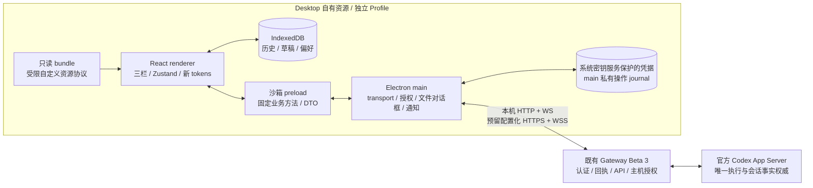
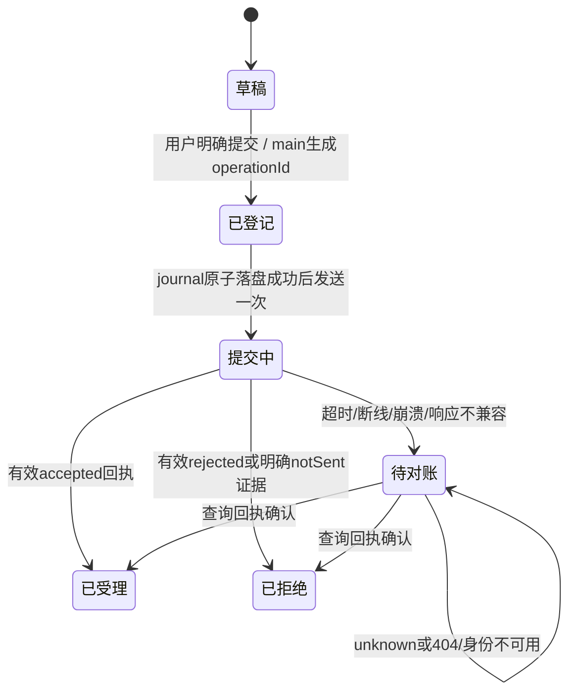

# P4.0｜Desktop 架构与安全设计

本文件是待用户审阅的设计，**没有实现新的 Electron 客户端**。研究基线为 `3c7a778`；决策来源为 [P4.0 任务](https://www.notion.so/41a5421e690b813b8004c9495eed1027) 与 [2.0 正典](https://www.notion.so/4135421e690b815eb404c3024c860134) 的 2026-11-16 裁定。2026-11-17 整理。目录、IPC 命名、缓存预算属于实施建议，不能读作已经通过运行验证。

## 1. 已定边界与当前源码事实

已定：Electron + React + TypeScript、Vite/pnpm、Zustand、IndexedDB、Tailwind CSS + 新 Design Tokens；独立资源和 Profile；Navigation / Conversation / Inspector 三栏；Oracle Eye；Light / Dark / OLED Dark。旧 Trusted CSS Themes、Theme API v1、导入、迁移和旧主题引擎全部退出新版依赖，不删除历史文件。Android Compose 页面不作为共享 UI。

主进程负责 Gateway 通信、凭据和有限平台能力；Gateway 与官方 Codex App Server 保持通讯/执行权威。无 ACP、自建 Harness、Agent Loop、Ubuntu Tray、旧应用数据迁移。当前运行的 Gateway Beta 3 不重启、不替换、不改配置、不另建测试实例。P4.0 不连接它；后续真实联调限定本机 HTTP/WS 与专门测试项目。

| 当前 main 的事实 | 设计含义与依据 |
| --- | --- |
| Desktop 仍验证 `127.0.0.1` Bridge URL，再 `loadURL`；已开启 sandbox/contextIsolation 并关闭 Node/webview | 保留安全底线，替换资源和通信入口。[main.cjs:9](../../apps/desktop/main.cjs#L9)、[main.cjs:30](../../apps/desktop/main.cjs#L30)、[main.cjs:115](../../apps/desktop/main.cjs#L115) |
| 打包壳会调用 `ensureBridge`，其内部可以执行 `systemctl --user start oraculum-bridge.service` | 新客户端必须完全退出这条生命周期路径，不能仅将服务名改成 Gateway。[runtime.cjs:13](../../apps/desktop/runtime.cjs#L13)、[runtime.cjs:48](../../apps/desktop/runtime.cjs#L48)、[main.cjs:119](../../apps/desktop/main.cjs#L119) |
| 现构建只复制壳、启动页与品牌图片；Forge 仍使用旧 `oraculum` GUI 包/程序名 | 新资源、包身份、入口和协议清单需要独立调整；避免与 Gateway 的 `oraculum` CLI 冲突。[build-desktop.mjs:19](../../scripts/build-desktop.mjs#L19)、[build-desktop.mjs:30](../../scripts/build-desktop.mjs#L30)、[forge.config.cjs:15](../../packaging/forge.config.cjs#L15) |
| Profile 已验证绝对路径、归属、私有权限与符号链接；当前默认目录及旧迁移提示属于旧版语义 | 复用防护原则，使用新命名空间，不扫描/导入旧状态。[paths.cjs:17](../../apps/desktop/paths.cjs#L17)、[paths.cjs:34](../../apps/desktop/paths.cjs#L34) |
| Gateway 已有协议 2.1、配对/换 token、HTTP/WS、operations、Snapshot 和历史 revision | 新客户端消费现有协议；具体能力对照 [复用与 API 映射](02-源码复用与API映射.md)，不复刻 Bridge transport。[protocol/index.ts:11](../../packages/gateway-protocol/src/index.ts#L11)、[server.ts:102](../../gateway/src/server.ts#L102) |

[Phase 0 Desktop 规格](../phase0/06-实施阶段与独立交付.md#2-ubuntu-desktop-具体设计) 的进程与数据分层仍可用；其中“高级旧主题可选”“停止 Gateway 验离线”“另起隔离 Gateway”等旧建议均以本次正典/任务限制为准，不进入新计划。

## 2. 目标架构与拟议目录



不新增通信守护进程或本地 Web 服务器。主进程是现有 API 的受限客户端，不执行工具、不启动 Codex、不管理 Gateway service、不直接读写 Codex 数据。

```text
apps/desktop/                         # 后续 P4.1 起才建立/调整
  src/main/
    index.ts                          # 窗口、生命周期、恢复菜单
    bundle.ts                         # 只读清单资源 handler
    ipc.ts                            # sender / frame / Schema / 大小限制
    gateway/{transport,auth,recovery}.ts
    storage/{profile,credential,journal}.ts
    platform/{files,notifications}.ts
  src/preload/index.ts                # contextBridge，逐方法，去除 IPC event
  src/contracts/desktop.ts            # IPC DTO；引用 gateway-protocol 类型
  src/renderer/
    app/                              # 三栏、连接页、设置
    features/                         # 提取/适配成熟业务组件
    state/                            # Zustand 投影、选择、加载状态
    storage/                          # IndexedDB 三库与版本升级
    styles/                           # Tailwind + 新 tokens，无旧主题依赖
    assets/                           # 已批准 Oracle Eye、本地字体/图标资源
  vite.config.ts
  resources/                          # 程序图标、许可证、完整性清单
```

产物建议：`dist/main`、`dist/preload`、`dist/renderer` 连同必需本地资源由 Desktop 包拥有；程序/DEB 名使用 Phase 0 既定方向 `oraculum-desktop`。版本与来源写入构建清单，禁止包含用户 Profile、Gateway、Codex 可执行文件、Bridge、旧 themes 或私有部署配置。继续用锁文件与来源/hash 检验，不顺带升级整仓依赖。本阶段不构建 DEB。

## 3. 资源、渲染与 IPC 安全契约

### 3.1 本地资源

建议固定 origin `oraculum-app://bundle/`：在 `ready` 前登记 `standard` / `secure`，使用锁定版本支持的 `protocol.handle`，在窗口所属 session 注册。只将打包清单内 GET/HEAD 文件映射为资源，检查 host、规范化路径、解码绕过、越界和符号链接；不将 URL 拼成任意磁盘路径。无 `bypassCSP`、远程 JS、任意目录映射或自定义协议 API 代理。稳定 origin 为 IndexedDB 提供独立存储边界；这来自 [Electron 44.9.1 protocol 文档](https://github.com/electron/electron/blob/v44.9.1/docs/api/protocol.md)，并非本轮运行证据。

打包 renderer 采用 CSP：脚本、样式、字体以自身资源为主；禁用 `object`、`frame`、远程连接和远程脚本，不启用 `unsafe-eval`。Markdown 图片先通过 Gateway 取已授权内容，再提供限时本地句柄/受限 blob；不能任由 Markdown 外链图片发请求。预览不执行 HTML/脚本；PDF worker 随包提供。外链仅用户点击后，经 main 校验 `https/http` 才交系统浏览器；`file:`、`javascript:`、自定义协议和远程文件路径拒绝。

持续保留 `nodeIntegration:false`、`contextIsolation:true`、`sandbox:true`、`webSecurity:true`、`webviewTag:false`。全部新窗口、外部导航、重定向默认拒绝；权限默认拒绝，必要剪贴板写入单独控制。开发预览与打包应用不能通过 `--no-sandbox` 或关闭 webSecurity 获得“通过”。这些是 [Electron 安全建议](https://www.electronjs.org/docs/latest/tutorial/security) 在本项目边界上的应用。

### 3.2 有限 IPC

以下为建议接口族，不是通用 RPC，也不是已实现的方法列表。

| 暴露的方法族 | main 允许的行为 | 关键拒绝条件 |
| --- | --- | --- |
| `connection.configure/connect/disconnect/status` | 校验并选择 endpoint，读取状态；配对码只用于当前配对调用 | URL 用户名/密码、查询或 fragment、远程明文 HTTP、请求头透传、凭据回读 |
| `projects.list/browse/register`、`threads.list/read/mutate` | 固定动作枚举与 Gateway DTO；动作逐项对应 API；所有写入走 journal | 未知动作、任意原生 RPC、任意 URL/method、超限游标/正文 |
| `history.page/details/snapshot`、`models.list`、`extensions.read`、`account.read` | 固定的查询及有界结果，能力降级 | 将缓存当成授权、无限详情/分页、绕过项目作用域 |
| `turn.start/interrupt/steer`、`interaction.respond`、`operation.get` | main 生成/校验 operationId、持久记录、发送/对账 | 未决写自动重发、复用 ID 更换正文、旧 epoch/turn/interaction |
| `attachments.choose/upload/remove`、`files.browse/preview/save` | 原生对话框选本地文件；Gateway 取项目文件；返回不透明句柄 | renderer 指定任意绝对本地路径、命令执行、主机项目磁盘直读、隐式覆盖 |
| `events.subscribe`、`appearance.recover` | 固定事件 DTO + unsubscribe；恢复内置外观 | 原始 `ipcRenderer`、event/sender、Electron 对象、任意 channel |

每个 handler 必须同时检查注册窗口 `webContents`、存活的 main frame、精确允许 URL/origin，再校验 DTO 与字节/数组预算；iframe 与其他窗口即使同源也不能借用权限。事件回调移除 Electron event，窗口关闭/重载后注销。主进程返回结构化错误码、范围、可恢复说明；不回显输入、认证头、完整主机路径或敏感异常。输入校验不能代替 Gateway 授权，Gateway 每次仍做自己的检查。依据：[现有协议校验](../../packages/gateway-protocol/src/index.ts#L14)、[Electron Context Isolation](https://www.electronjs.org/docs/latest/tutorial/context-isolation)。

## 4. Endpoint、认证与凭据

### 4.1 可移植连接

配置分为 `origin` 与规范化 `basePath`（默认 `/`），API 与 WS 都由同一连接配置生成，避免 `new URL('/api/v2', endpoint)` 丢弃非根路径。禁止私有 VPS/IP、SSH、代理、用户固定端口或 `/oraculum/` 成为产品默认值。

| 模式 | 规则与验证范围 |
| --- | --- |
| 本机 HTTP / WS | 明文仅允许经 URL 规范化后的明确 loopback 字面地址（首版建议 `127.0.0.1`、`[::1]`；不接受解析后可能指向远端的任意主机名）。WS 从同一 origin 协议映射生成；使用已运行服务的实际配置输入，无自动端口扫描、服务启动或配置修改 |
| 配置化 HTTPS / WSS | origin 可配置、系统信任验证、禁止忽略证书错误与降级明文；保留适配入口和负向 fixture。本 Phase 不要求真实 TLS/公网验收，不能以入口存在声称可用 |
| Base Path | 接受 `/` 和经过规范化、末尾 `/` 的非根路径；拒绝 `..`、双斜线、模糊编码、query/fragment。HTTP/WS、文件下载与重连统一使用，不各自拼接 |

main 的非浏览器 HTTP 与 WebSocket 客户端通过 `Authorization: Bearer …` 以及 `X-Oraculum-Protocol: 2` 认证；不设置 renderer 的 `oraculum-app:` 为 HTTP Origin，不发 Cookie，不把 token 放 URL/query/subprotocol。不得伪造 Host；若使用 Origin，则必须为当前配置 Gateway 接受的同源值。禁止跨 origin 重定向和认证头转发。依据：[server.ts:38](../../gateway/src/server.ts#L38)、[server.ts:70](../../gateway/src/server.ts#L70)、[server.ts:209](../../gateway/src/server.ts#L209)。主进程通信避免要求 Gateway 为 renderer 增加 CORS。

### 4.2 身份生命周期

main 先读 `health` 得到 installationId，再通过正规配对接口提交主进程生成的 deviceId/32-byte deviceCredential、一次性码与标签；UI 只接收状态、设备标签和脱敏标识。先将新凭据安全保存为“待配对”，配对结果不明时用相同身份尝试正常 token 换取来确认，不循环消费配对码、不生成新身份掩盖不确定结果。access token 只驻留 main 内存，到期前单次合并续期；失效只按可证明安全的认证恢复流程处理，不能自动重试原写入。Gateway 当前最长 access TTL 为 10 分钟，长期凭据经设备摘要核验；每次活动检查撤销。[auth.ts:21](../../gateway/src/auth.ts#L21)、[auth.ts:68](../../gateway/src/auth.ts#L68)、[auth.ts:82](../../gateway/src/auth.ts#L82)。

凭据建议沿用 Phase 0 已研究的 Electron 44 `safeStorage` 同步小凭据路径：`ready` 后同时检查 encryption 可用与 Linux 实际密钥环 backend；`basic_text`、未知 backend、密钥环锁定时不落明文、不清除旧密文，显示可恢复的“解锁系统密钥环”状态。密文原子写入 main 私有目录，文件 0600，目录 0700。异步 API 在当前版本虽存在，但官方说明仍有 fallback provider；未经证明可拒绝弱保护前，不仅凭“available”改用它。依据：[已锁定的 Electron safeStorage](https://github.com/electron/electron/blob/v44.9.1/docs/api/safe-storage.md)、[Desktop 依赖声明](../../apps/desktop/package.json#L6)。P4.2/P4.4 必须在真实 GNOME Keyring 上验证，P4.0 未读取凭据。

endpoint / installationId / deviceId 共同定义数据身份。切换 endpoint 不搬运信任和未决操作；installationId 改变转到新连接身份，保留旧数据为本地隔离记录。撤销或重新配对不自动恢复旧写权限。退出登录与关闭窗口分开：关闭不撤销设备；明确“撤销此设备”才调用 logout；响应不明先保留待对账记录，不靠清本地记录假定成功。

## 5. Profile、Zustand、IndexedDB 与可靠写入

### 5.1 存储分层

建议正式 Profile 为 `$XDG_CONFIG_HOME/oraculum-desktop-v2/`，开发为独立 `oraculum-desktop-v2-dev/`，自动化测试用临时独立目录。仅在应用自己的新目录创建状态，不读取旧 `oraculum` / `oraculum-phase0b`、WebView、Android 或 Gateway 库。保留现有路径归属、0700、不跟随符号链接检查；锁定单实例，第二实例只聚焦已存在窗口，不并发写安全记录。

| 数据 | 存储建议 | 清理/损坏规则 |
| --- | --- | --- |
| 当前选择、三栏、加载/错误、流式临时投影 | Zustand，按功能 slice；只存 UI/派生状态 | 重开从本地持久层和 Gateway 校正；不再复制整个旧 `store.ts` |
| 历史页、列表、Turn/Item、revision、游标、事件检查点 | `oraculum-history-v1` IndexedDB | 有界 LRU，可丢弃重建；页、事件投影与 checkpoint 在同一事务更新 |
| 未发送文本、附件引用、draftRevision | `oraculum-drafts-v1` IndexedDB | 不参与 LRU；取消/清缓存不删；quota 或事务失败明确提示未保存 |
| 阅读锚点、展开、最近选择、新三主题与字号偏好 | `oraculum-preferences-v1` IndexedDB | 不跨端同步；升级失败不清草稿；损坏回退内置默认 |
| 凭据密文、endpoint、最小窗口/外观恢复配置 | main 私有文件 | 原子替换、0600；凭据明文/密文不进入 renderer/IndexedDB/日志；连接页只经有限 DTO 输入/展示 endpoint 与偏好，敏感连接信息不进诊断 |
| operationId、目标、请求摘要、draftId/draftRevision（适用时）、提交状态与已知回执 | main 独立操作 journal | 发送前持久，未知不被 LRU、缓存重建、重配对或主题恢复删除 |

IndexedDB 键的作用域包括 `endpointKey(origin+basePath)`、`installationId`、`deviceId`、`projectId`、`threadId`；页/详情再加 historyRevision、turnId/itemId 和分页位置。库版本独立于协议版本；升级仅升级本客户端新库。历史内容是可校正投影，客户端草稿/偏好是本机数据，主进程 journal 是通信安全记录，三者不互相提升权威。

初始容量/批量参数在 P4.3 以真实长历史测量决定。已有能力上限可直接依据 capabilities；不做“缓存提升 X 倍”的未经测试承诺。流式 delta 合并到短批次，最终完整 item 提交；列表刷新保留已加载窗口和阅读锚点，失效时重取必要页，避免切栏即全部重载。历史 lease 过期不等于 revision 改变；客户端尊重返回 revision，不自创历史版本。[history.ts:234](../../gateway/src/history.ts#L234)、[service.ts:687](../../gateway/src/service.ts#L687)。

### 5.2 写前持久与未知结果



main 为每次明确用户写意图创建 UUIDv4；先保存最小 journal（身份、目标、kind、operationId、请求摘要、时间，提交草稿时另含 draftId/draftRevision），落盘完成才发网络请求；同一 journal 文件/队列串行原子替换并同步磁盘。失败则禁止发送并保留草稿。请求正文驻留当前调用，journal 不做自动重放队列；不复制会话或工具执行权威。

drafts IndexedDB 与 main journal 不具备跨库原子事务：先确认该 draftRevision 已持久化，再由 main 登记关联；同一次提交意图的 draftId/revision 重复 IPC 单飞并返回已有 operationId，适用于处理中、未决和已 accepted 的提交。取得有效 rejected 回执或持久可证的 notSent 后，用户可显式发起新 attempt（持久关联新的 operationId），无需修改相同正文；不得自动创建 attempt 绕过 unknown。accepted 回执先落 journal，renderer 才幂等标记对应草稿版本已提交并清理匹配版本。若在这两步之间崩溃，启动先核对 journal 关联，不能把这份旧正文呈现为新的“未发送”意图；未决则显示关联的待对账状态，期间新增的 draftRevision 继续保留且不能被旧回执清除。此关联只用于本机提交去重，不将 Gateway 误当支持幂等重发。

崩溃时“提交中”恢复为待对账；有效 accepted 是请求受理/交付确认，不是 Turn 已完成，也不能把项目/认证等操作误称为原生执行。超时、结构错误、一般 HTTP 错误和 receipt 404 均不能证明未执行。恢复先查 `/operations/:operationId`，再按真实 Snapshot/原生事实校正；Snapshot 最近 100 条操作不是全部未决账本，要逐个查本地未决 ID。不以相似消息文本认领成功、不生成新 ID 重发、不让“清缓存/忽略”解除安全限制。有效 rejected 回执或明确 notSent 证据可结束原提交并由用户重新提交；不能要求当前服务从未承诺返回的可选字段才允许处理拒绝。Schema 有可选 `delivery`，当前 [receipt()](../../gateway/src/service.ts#L30) 不填它，不能按缺省推断 notSent。[OperationReceipt](../../packages/gateway-protocol/schema/v2.json#L133)、[server.ts:157](../../gateway/src/server.ts#L157)、[service.ts:697](../../gateway/src/service.ts#L697)。

安全限制按 Gateway 的项目/会话范围及具体操作分类，不能把某一会话 unknown 扩大成永久全局只读；也不能比服务端放松权限、审批和未知写屏障。Gateway 已先预留 unknown 后执行，重复 ID 拒绝并要求查询。[store.ts:171](../../gateway/src/store.ts#L171)、[service.ts:429](../../gateway/src/service.ts#L429)。UI 保留草稿副本；确认受理后只清与提交时 draftRevision 一致的草稿，期间新增文字不能被回执清掉。附件 held/unknown 不擅自释放或再上传。

### 5.3 断网与恢复

1. 启动立即显示本地资源、缓存和草稿；联网状态为连接中，缓存只读标注“待校正”。不自动创建 thread 或发送草稿。
2. main 完成认证与 capabilities/协议检查；major 不兼容禁止在线操作，minor/能力按当前响应降级。unsupported/unavailable 显式说明；unverified 不伪装 verified，也不因为未观测就永久禁用正规用户操作。[service.ts:274](../../gateway/src/service.ts#L274)。
3. WS 用当前身份的 epoch/afterSeq 恢复；按 seq 去重、缺口回补。resetRequired/epoch 改变则丢弃连续性假设，保留缓存供阅读，刷新 Snapshot、回执、权限/交互及相关历史。
4. 应用事件/失效与持久 checkpoint 在同一历史库事务完成后，才向 main 确认已处理序号；事务失败不推进 checkpoint。未知 state event 使范围失效，informational 可跳过。不能直接持久 `headSeq` 假定已处理全部事件。[reconcile.ts:11](../../gateway/src/reconcile.ts#L11)、[protocol/index.ts:43](../../packages/gateway-protocol/src/index.ts#L43)。
5. Snapshot 的 observedStartSeq/EndSeq 只是 Gateway 观察窗口，不是 Codex 原子水位；结合同步状态、连续事件与必要详情校正。不在恢复基线后盲目拼接 delta；完整终态覆盖流式临时内容，不重复生成消息。[service.ts:687](../../gateway/src/service.ts#L687)、[reconcile.ts:44](../../gateway/src/reconcile.ts#L44)。
6. 对账本地未决操作后，仅对已确认授权/范围/epoch/Turn/interaction 的动作开放写入。历史被截断仅表示内容不完整，不能一律阻断已确认空闲会话；缓存也不能解锁权限和审批。

客户端断网后有界退避（尊重 retryAfter，增加抖动，前台恢复合并一次），只重试安全读取；不轮询所有旧页、不制造无意义刷新。断网/休眠/锁屏测试通过断开客户端 transport 或 fixture 进行，**不停止、重启或扰动现有 Gateway**。

## 6. 文件、通知与窗口退出

本机附件由原生对话框选择，main 检查实际文件、类型/大小后上传；renderer 只持不透明本地句柄和受控进度，不用任意绝对路径调用读取。项目目录/文件、成果即使与 Gateway 同机，也必须经过 Gateway 的授权路径。成果保存使用原生 Save Dialog，文件名消毒、不自动覆盖、校验长度/摘要与 MIME；取消/中断不宣称成功，系统打开仅在明确用户动作后执行。当前 blob 下载校验理念可参考，现实现与旧 origin/Cookie 耦合需替换。[artifacts.cjs:8](../../apps/desktop/artifacts.cjs#L8)、[server.ts:163](../../gateway/src/server.ts#L163)。

通知从新 Gateway 业务事件和最新交互状态派生，按事件身份去重；标题不含消息正文/凭据，点击只聚焦并导航，重新读取当前会话，不在通知中批准操作。旧 `/notifications` Cookie 轮询和 `executeJavaScript(location.hash)` 不移植，改为受限导航事件。[notifications.cjs:19](../../apps/desktop/notifications.cjs#L19)、[notifications.cjs:42](../../apps/desktop/notifications.cjs#L42)。最小化时应用仍运行，能否收到通知由真实 GNOME/Wayland 状态证明；关闭后不承诺提醒。

关闭最后窗口即退出，无 Tray、无驻留服务。退出时停止接收新写入、完成本地草稿/布局/journal 刷盘并断开客户端连接；不发送 interrupt、不撤销设备、不停止 Gateway/Codex。进行中的 Turn 继续由官方执行；下次启动先对账。原生确认框仅用于确实未保存或保存失败的本地内容，不能为了每次退出增加笼统警告；未决写持久保存后允许退出。强杀无法保存尚未落盘的最后输入，因此编辑时增量保存，不能只依赖退出回调。现“最后窗口关闭退出”的底线见 [main.cjs:131](../../apps/desktop/main.cjs#L131)。

保留原生菜单/快捷键 `Ctrl+Shift+0` 的“恢复内置外观”方向，但只重置新三主题/字号/布局必要偏好，不能访问旧 Theme API 或清草稿、凭据、操作 journal。恢复入口独立于 renderer CSS；资源损坏时显示本地恢复说明，失败不转向加载 Gateway 网页。[main.cjs:88](../../apps/desktop/main.cjs#L88)。

## 7. 实施时必须证明的边界与待审阅项

| 风险 | 后续验收出口 |
| --- | --- |
| 主进程代理扩大权限 | 伪 sender、iframe、外部页、任意 IPC/URL/path、超大 payload 全部拒绝；无凭据进入 renderer |
| 弱凭据保护 | GNOME Keyring 可用/锁定/缺失/basic_text 分支，安全失败且不破坏已有密文 |
| 清理误删持久状态 | 清历史、quota、DB upgrade/损坏、恢复外观后草稿和 unknown 仍在；journal失败时网络写次数为零 |
| ACK 丢失造成重复写 | 五个故障点 fixture：落盘前、发出后、原生已接收、ACK前、客户端重开；每个意图仅发送一次 |
| 事件与历史错序 | gap/reset/epoch、旧 revision 页晚到、压缩/回退、截断详情，不重复消息、不回退checkpoint、不假解锁 |
| 服务耦合回流 | 新构建/源码无 Bridge service 管理，无 Gateway启动/停止/重启、无私有 endpoint，包内 UI 完整且不带后端 |

本轮没有发现需要改变冻结架构的前置阻塞。首次启动建议 Light（与本轮原型一致），随后恢复本机所选的 Light / Dark / OLED Dark，不增加第四套主题。供用户审阅的是此设计及视觉方案；目录细分、IPC 方法命名、缓存容量属于实施建议，后续按本次审阅结果收敛。若后续发现 API 缺口，只记录契约/版本/最小复现和 UI 降级，不在 Desktop Task 顺手修 Gateway；先独立讨论并取得授权，隔离验证也不能擅自新增测试 Gateway。P4.0 交付后保持 `In progress`，不自动启动 P4.1。
