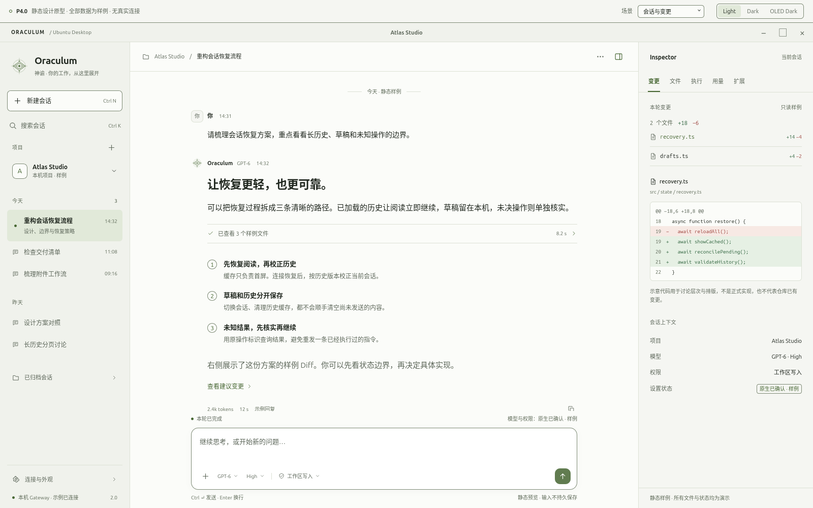
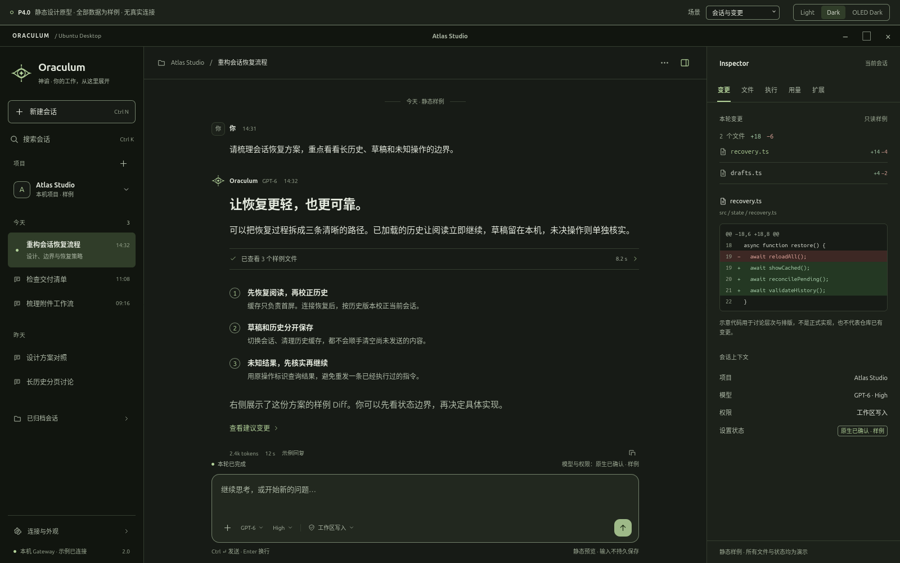
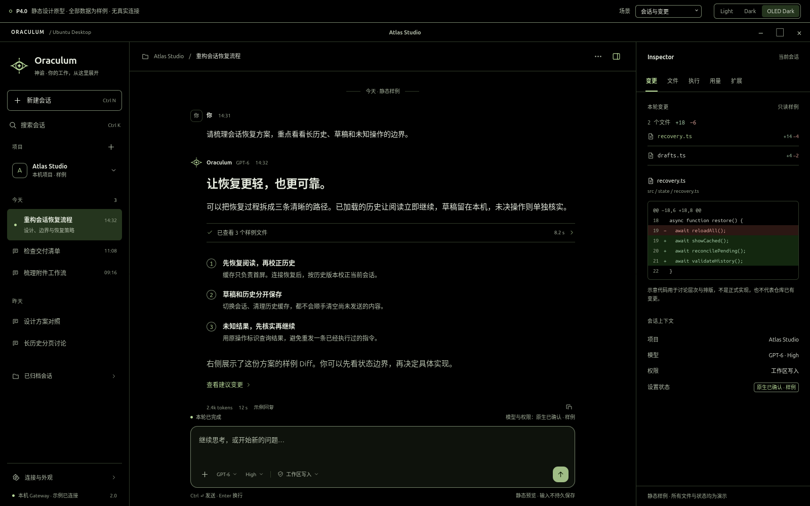

# Oraculum 2.0 Ubuntu Desktop｜P4.0 审阅包

**2026-11-17 最新决定：用户已接受 P4.0（含完整 Outline 标志修正）与 P4.1 独立客户端基础；P4.2 已授权实施，保持 In progress 待审阅。当前工程说明见 [Desktop README](../../apps/desktop/README.md) 与 [P4.2 架构与审阅指南](p42/README.md)。以下保留 P4.0 历史交付记录，其中“等待确认/不进入 P4.1”仅描述当时状态。**

来源：[P4.0 任务](https://app.notion.com/p/41a5421e690b813b8004c9495eed1027)、[2.0 项目正典](https://app.notion.com/p/4135421e690b815eb404c3024c860134)、根 [AGENTS.md](../../AGENTS.md)。完整读取于 2026-11-17（上海时间）；源码研究基线为 `3c7a7787b31c3fc007c19c993e0b9f8f78f12923`，开始时 main 与新获取的 origin/main 一致、工作区干净。

最新 Notion 决定覆盖本地历史资料中“Desktop 暂缓”“旧主题可选复用”“可另起测试 Gateway”等冲突建议。交付范围限本目录文档和设计资产，正式 Desktop/Web/Gateway/Android、历史主题文件与发布基线均不改动。现有 Gateway Beta 3 未连接、重启、修改或部署替代实例。

2026-11-17 用户收尾反馈：导航品牌标志与对话头像统一改用原版完整 Outline SVG；连接页沿用同一资产。三主题通过既有 accent 着色，SVG 路径/比例/细节及现有尺寸保留，9 张受影响截图同步更新。Diff 10px 字号与其他已认可 UI 不调整。

## 审阅入口

建议先对比三主题截图，再打开原型切换场景，最后审阅架构与能力边界。截图均来自独立静态 HTML，数据全部为样例，**不是正式 Electron 客户端或真实 Gateway 联调截图**。

| 内容 | 交付 |
| --- | --- |
| 架构图、目录、main/preload/renderer、认证/IPC、Profile/存储/恢复/退出 | [01 架构与安全设计](01-架构与安全设计.md) |
| 可复用/需解耦/新版舍弃矩阵、实际 API、能力缺口 | [02 源码复用与 API 映射](02-源码复用与API映射.md) |
| 三主题 tokens、排版/间距/组件、状态与键鼠方案 | [03 视觉系统与交互](03-视觉系统与交互.md) |
| P4.1–P4.4 依赖、小步交付、验收、回退与 Gateway 保护 | [04 分步实施与验收计划](04-分步实施与验收计划.md) |
| 独立 HTML/CSS/JS，无构建依赖、无真实动作 | [静态原型](prototype/index.html)、[配色源](prototype/tokens.css) |
| 检查证据、截图索引、边界与剩余验证 | [验收记录](验收记录.md)、[只读检查脚本](verify.mjs) |

| Light | Dark | OLED Dark |
| --- | --- | --- |
| [打开原图](screenshots/01-light-conversation.png) | [打开原图](screenshots/02-dark-conversation.png) | [打开原图](screenshots/03-oled-conversation.png) |







## 本地预览

从仓库根目录运行以下**纯静态文件预览**，浏览器打开终端给出的随机 loopback 地址。它只公开 `prototype/`，没有 Gateway/API，不代理线上服务；用完 `Ctrl+C` 退出。

```bash
python3 -m http.server 0 --bind 127.0.0.1 --directory upgrade/phase4/prototype
```

顶部审阅工具可切 Light / Dark / OLED Dark，以及会话、审批、离线未决操作、首次连接。Inspector 可切变更、文件、执行、用量、扩展；支持搜索样例会话、收起 Inspector、页签键盘与临时文本输入。业务按钮禁用或明确提示未执行，不会发送/审批/配对/下载。直接本地打开 HTML 是备选方式，本轮浏览器 QA 使用上述静态 HTTP 方式。

可在地址后附 `?theme=oled&scene=offline` 等参数；`theme` 为 `light/dark/oled`，`scene` 为 `conversation/approval/offline/connect`，`panel` 为 `diff/files/process/usage/extensions`。参数只选择白名单 fixture。

## 已定案、建议与待审阅

- **已定案**：Electron/React/TypeScript、Vite/pnpm、Zustand、IndexedDB、Tailwind/全新 tokens、三栏、Oracle Eye、三主题；旧主题系统完全退出新版；main 管通信与凭据、有限 IPC；仅本机 HTTP/WS 实际联调，HTTPS/WSS 保留入口；无 Tray、无旧应用状态迁移、无 ACP/自建执行循环。
- **实现建议**：自有资源协议与目录命名、三 IndexedDB 库 + main journal、首次 Light、组件密度/间距、缓存预算与刷新调度。均在文档中标为建议，没有借研究任务冻结新的架构决定。
- **本次最终确认**：原版完整 Outline 标志及对应截图；整体布局、三主题和审美方向已获基本认可，Diff 字号整改建议已由用户撤回。任务结项仍由用户确认。

P4.0 不实现正式 React 页面、Electron 安全运行时/IPC、IndexedDB 数据层或真实写入，不构建/安装/发行 DEB，不修改服务、网络、凭据、原生 Codex 项目/会话或父项目历史。后续只有在用户接受本阶段后，才决定建立/启动 P4.1。
